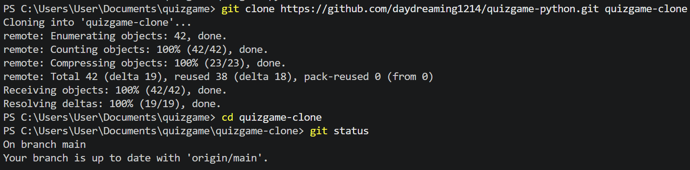
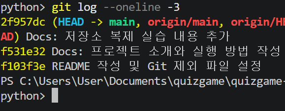
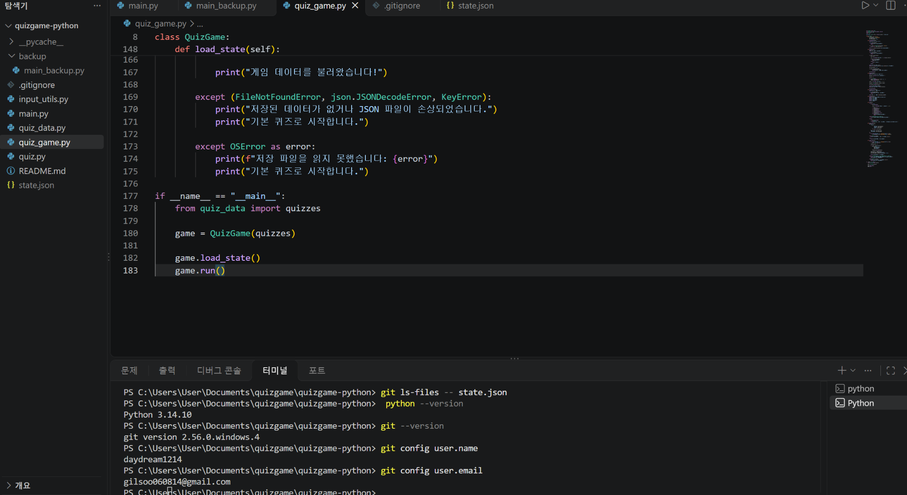
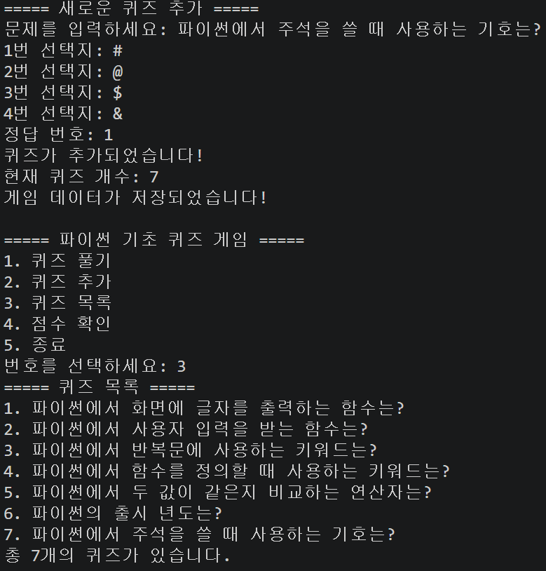
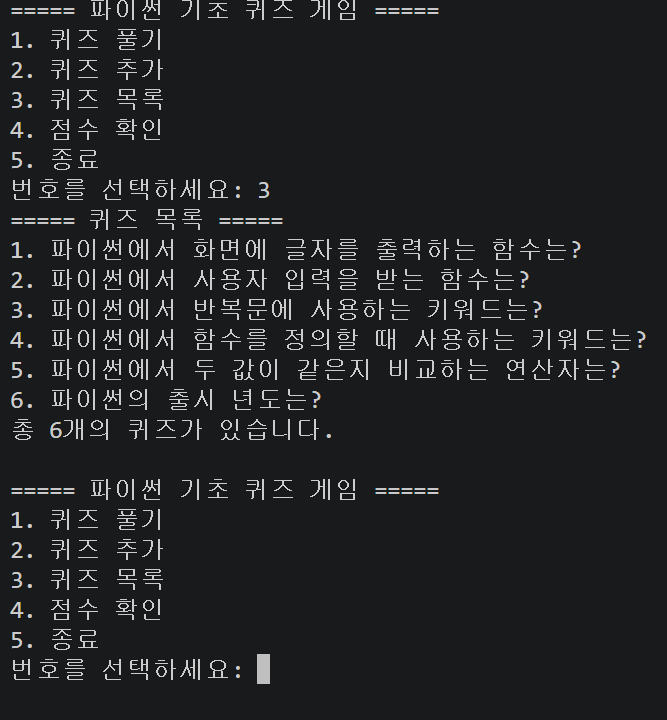
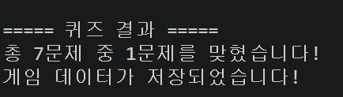
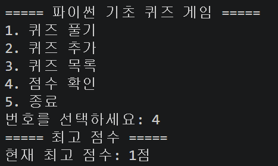
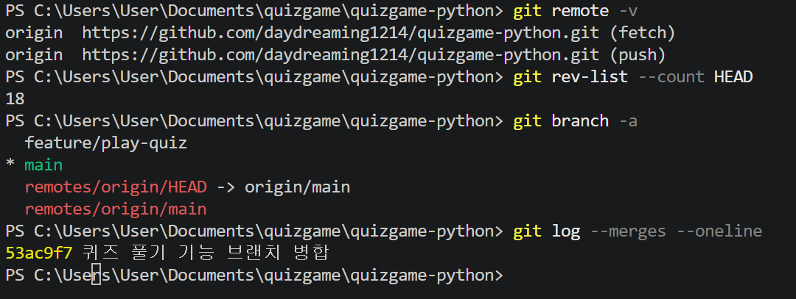
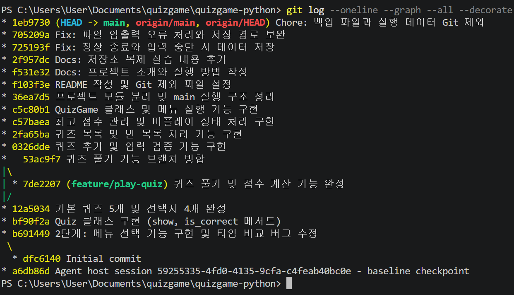
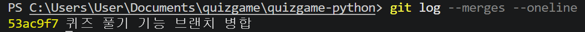

# 파이썬 기초 퀴즈 게임

## 1. 프로젝트 개요

Python으로 만든 터미널 기반 퀴즈 게임입니다.

메뉴에서 퀴즈 풀기, 퀴즈 추가, 퀴즈 목록, 최고 점수 확인을
선택할 수 있습니다.

퀴즈와 최고 점수를 JSON 파일에 저장하여 프로그램을 종료하고
다시 실행해도 데이터를 사용할 수 있습니다.

## 2. 퀴즈 주제와 선정 이유

퀴즈 주제는 Python 기초입니다.

Python을 배우면서 익힌 문법과 개념을 복습하기 위해 선택했습니다.
직접 문제를 만들고 풀면서 학습한 내용을 확인하고자 했습니다.

각 퀴즈는 문제, 선택지 4개, 정답 번호로 구성됩니다.

## 3. 실행 방법

### 실행 환경

- Python 3.10 이상
- 터미널에서 실행
- 외부 라이브러리 설치 불필요

### 실행 절차

1. 프로젝트를 다운로드하거나 Git으로 clone합니다.
2. 터미널에서 프로젝트 폴더로 이동합니다.
3. 다음 명령을 실행합니다.

```bash
python quiz_game.py
```

Windows에서 `python` 명령을 사용할 수 없다면 설치 환경에 따라
다음 명령으로 실행할 수 있습니다.

```bash
py quiz_game.py
```

## 4. 기능 목록

### 퀴즈 풀기

- 등록된 퀴즈를 순서대로 출제합니다.
- 선택지 번호를 입력하면 정답 여부를 알려줍니다.
- 모든 문제를 풀면 전체 문제 수와 정답 수를 표시합니다.
- 기존 최고 기록과 비교하여 최고 점수를 갱신합니다.
- 플레이를 마치면 데이터를 저장합니다.

### 퀴즈 추가

- 문제, 선택지 4개, 정답 번호를 입력하여 등록합니다.
- 등록한 퀴즈를 파일에 저장합니다.

### 퀴즈 목록

- 등록된 문제와 전체 퀴즈 개수를 표시합니다.
- 퀴즈가 없으면 안내 메시지를 표시합니다.

### 점수 확인

- 최고 점수를 확인합니다.
- 점수는 정답 개수 기준입니다.
- 아직 퀴즈를 풀지 않았다면 안내 메시지를 표시합니다.

### 프로그램 종료

- 메뉴에서 종료를 선택할 수 있습니다.

## 5. 파일 구조

| 파일 | 역할 |
|---|---|
| main.py | 프로젝트 시작 코드 |
| input_utils.py | 공통 입력과 입력값 검사 |
| quiz_data.py | 기본 퀴즈 데이터 |
| quiz.py | 개별 퀴즈를 표현하는 Quiz 클래스 |
| quiz_game.py | 게임 진행과 데이터 저장·불러오기 |
| state.json | 실행 중 생성되는 퀴즈와 최고 점수 데이터 |
| README.md | 프로젝트 소개와 실행 방법 |
| .gitignore | 실행 데이터와 백업 파일 등의 Git 제외 설정 |
| docs/screenshots/ | 개발환경과 프로그램 실행 화면 |

## 6. 클래스 구성

### Quiz

개별 퀴즈의 데이터와 동작을 관리합니다.

- question: 문제
- choices: 선택지 목록
- answer: 정답 번호
- show(): 문제와 선택지 출력
- is_correct(): 정답 여부 확인

### QuizGame

게임 전체 진행과 데이터 관리를 담당합니다.

- show_menu(): 메뉴 출력
- run(): 메뉴 선택과 게임 실행
- play_quiz(): 퀴즈 출제와 채점
- add_quiz(): 퀴즈 등록
- list_quizzes(): 퀴즈 목록 출력
- show_best_score(): 최고 점수 출력
- save_state(): 데이터 저장
- load_state(): 데이터 불러오기

## 7. 데이터 파일 설명

데이터 파일 이름은 `state.json`이며,
과제에서 지정한 저장 위치는 프로젝트 루트입니다.

UTF-8 인코딩을 사용하며 다음 정보를 저장합니다.

| 필드 | 내용 |
|---|---|
| quizzes | 퀴즈 목록 |
| question | 문제 내용 |
| choices | 선택지 4개 |
| answer | 정답 번호 1~4 |
| best_score | 최고 정답 개수 |
| has_played | 퀴즈를 끝까지 푼 기록이 있는지 여부 |

아래는 데이터 구조를 보여주는 예시입니다.

```json
{
    "quizzes": [
        {
            "question": "파이썬에서 화면에 글자를 출력하는 함수는?",
            "choices": [
                "input()",
                "print()",
                "int()",
                "len()"
            ],
            "answer": 2
        }
    ],
    "best_score": 0,
    "has_played": false
}
```

저장 파일이 없거나 JSON 문법이 손상된 경우에는
안내 메시지를 출력하고 기본 퀴즈로 시작합니다.

state.json은 프로젝트 루트에 저장됩니다.
Git 관리에서는 제외되며, 파일이 없으면 기본 퀴즈로 시작합니다.
퀴즈 추가, 플레이 완료 또는 프로그램 종료 시 저장됩니다.

## Git 저장소 복제 실습

1. GitHub 저장소를 별도의 quizgame-clone 폴더에 clone했습니다.
2. 복제한 폴더에서 README를 수정하고 commit과 push를 수행했습니다.
3. 원래 quizgame-python 폴더에서 git pull을 실행했습니다.
4. 원래 폴더의 README와 최신 커밋에 변경 내용이 반영됐는지 확인했습니다.

### clone 실행 결과



### 원래 폴더의 반영 결과

아래 화면은 pull 명령 자체의 출력이 아니라,
원래 작업 폴더에서 가져온 커밋을 확인한 결과입니다.



## 실행 화면

### 개발환경


### 퀴즈 추가


### 퀴즈 목록


### 플레이 결과


### 최고 점수


## Git 저장소와 개발 이력

- 저장소: https://github.com/daydreaming1214/quizgame-python
- 커밋 이력: https://github.com/daydreaming1214/quizgame-python/commits/main/

### 커밋 수와 브랜치 증빙

증빙 화면 촬영 시점의 전체 커밋 수는 18개입니다.
전체 개수에는 병합 커밋 등이 포함되며, 기능별 작업 내용은
아래 Git 그래프와 커밋 이력 링크에서 확인할 수 있습니다.



### 기능별 개발 이력

메뉴, Quiz 클래스, 기본 문제, 퀴즈 풀기, 등록, 목록,
점수 관리, 파일 입출력 등을 작업 단위로 나누어 기록했습니다.



### 브랜치 생성과 병합

퀴즈 풀기 기능은 feature/play-quiz 브랜치에서 개발했습니다.
완성한 기능을 main에 병합했으며, 병합 커밋은
53ac9f7입니다.



## 개발 기록과 설계 이유

### 커밋 단위와 메시지 규칙

하나의 기능 구현이나 오류 수정이 완료되면 동작을 확인하고
작업 단위로 커밋합니다.

예를 들어 메뉴 구현, 퀴즈 등록, 최고 점수 관리,
파일 저장 오류 처리를 각각 구분하여 기록했습니다.

커밋 메시지는 변경 목적과 내용을 나타내도록 작성합니다.

- Feat: 새로운 기능 추가
- Fix: 오류 수정
- Docs: README와 설명 자료 수정
- Refactor: 동작을 유지하면서 코드 구조 개선
- Chore: Git 제외 설정 등 관리 작업

### 클래스를 사용한 이유

Quiz는 한 문제의 데이터와 정답 판정을 함께 관리합니다.
QuizGame은 여러 Quiz 객체와 최고 점수를 보관하고 게임을 진행합니다.

문제마다 객체를 만들면 각 문제의 선택지와 정답을 구분하기 쉽고,
관련 데이터와 기능을 같은 곳에서 관리할 수 있습니다.

함수와 딕셔너리만으로도 구현할 수 있지만, 게임 상태를 여러 함수에
전달해야 합니다. 클래스는 상태를 속성으로 보관할 수 있는 장점이
있으며, 작은 프로그램에서는 오히려 코드 구조가 복잡해질 수 있습니다.

정답 비교는 Quiz의 책임이며, 정답 수 누적과 최고 점수 갱신은
QuizGame의 책임입니다.

### 모듈 분리 기준

- 개별 문제의 데이터와 동작은 quiz.py에 둡니다.
- 게임 진행과 저장 상태 관리는 quiz_game.py에 둡니다.
- 여러 입력 과정에서 재사용하는 검증 함수는 input_utils.py에 둡니다.
- 기본 문제 데이터는 quiz_data.py에 둡니다.

### 브랜치 분리와 병합

퀴즈 풀기 기능은 feature/play-quiz 브랜치에서 개발했습니다.
main의 기존 코드와 작업 중인 변경을 분리하기 위한 목적입니다.

병합은 작업 브랜치의 변경을 main에 통합하는 과정입니다.
병합 전에는 변경사항을 커밋하고 기능 동작을 확인합니다.
충돌이 발생하면 양쪽 변경 의도를 확인해 해결한 뒤 다시 실행합니다.

실제 병합 커밋은 53ac9f7입니다.

### JSON을 선택한 이유와 한계

JSON은 리스트와 딕셔너리 형태의 데이터를 표현하기 쉽고,
텍스트 편집기에서 내용을 확인할 수 있습니다.
Python 표준 라이브러리로 처리할 수 있어 이 과제에 적합합니다.

현재 방식은 저장 파일 전체를 읽고 쓰므로 데이터가 커지면
메모리 사용량과 저장 시간이 증가합니다.
또한 여러 프로그램이 동시에 저장하면 다른 변경을 덮어쓸 수 있습니다.

현재 버전은 한 번에 하나의 프로그램만 실행하는 사용 방식을
전제로 하며, 파일 잠금이나 동시 저장 충돌 방지는 구현하지 않았습니다.
데이터가 커지거나 동시 접근이 필요하면 SQLite 등의 데이터베이스를
검토할 수 있습니다.

## 데이터 보호와 오류 대응

### 저장 시점과 입력 중단

퀴즈 등록 완료, 퀴즈 풀이 완료, 프로그램 종료 시 저장을 시도합니다.

Ctrl+C 또는 EOF가 발생하면 안내 메시지를 출력하고,
finally에서 현재 퀴즈 목록과 최고 점수 저장을 시도합니다.

등록 도중 중단한 미완성 문제는 목록에 추가되지 않습니다.
끝까지 풀지 않은 게임의 중간 정답 수는 최고 점수에 반영하지 않습니다.
풀이 중간 상태의 자동 저장과 이어하기는 구현하지 않았습니다.

### 입력 검증 사례

| 입력 상황 | 기대 동작 |
|---|---|
| 숫자 대신 abc 입력 | 안내 후 재입력 |
| 허용 범위 밖 번호 입력 | 범위 안내 후 재입력 |
| 빈 입력 | 안내 후 재입력 |
| 번호 앞뒤에 공백 입력 | 공백 제거 후 처리 |
| Ctrl+C 또는 EOF | 안내 후 저장을 시도하고 종료 |

### 불러오기 실패 시 동작

1. 기본 퀴즈, 최고 점수 0, 미플레이 상태로 게임 객체를 생성합니다.
2. 프로젝트 루트의 state.json을 읽습니다.
3. 정상적으로 읽으면 저장된 퀴즈와 점수를 반영합니다.
4. 파일 없음, JSON 문법 오류, 필수 키 누락 또는 파일 읽기 오류를
   감지하면 안내 메시지를 출력합니다.

파일이 없거나 JSON 문법이 손상된 경우에는 초기 기본 데이터로
실행됩니다. 저장된 데이터의 자료형과 값 전체를 검증하거나,
불러오기 실패 시 모든 상태를 되돌리는 처리는 아직 구현하지 않았습니다.

기본 데이터로 실행한 뒤 종료하면 저장을 시도하므로,
기존 파일을 보존하려면 실행 전에 백업해야 합니다.

### 수동 백업 방법

자동 백업과 자동 백업 복원은 구현하지 않았습니다.
중요한 데이터는 프로그램을 종료한 상태에서 수동으로 복사합니다.

프로젝트 폴더의 PowerShell에서 다음 명령을 실행합니다.
날짜와 시간이 붙으므로 기존 백업을 덮어쓰지 않습니다.

```powershell
New-Item -ItemType Directory -Force .\backup | Out-Null
$backupStamp = Get-Date -Format "yyyyMMdd-HHmmss-fff"
Copy-Item .\state.json ".\backup\state-$backupStamp.json"
```

백업 파일을 열어 문제 목록과 점수가 정상인지 확인합니다.
손상된 데이터를 복사한 백업은 정상 데이터 복구에 사용할 수 없습니다.

### 수동 복구 방법

1. 게임을 종료합니다.
2. backup 폴더에서 정상 데이터가 들어 있는 백업을 선택합니다.
3. 현재 state.json이 있다면 다른 이름으로 복사하여 보관합니다.
4. 선택한 백업을 프로젝트 루트에 복사하고 이름을 state.json으로 지정합니다.
5. 다시 실행하여 문제 목록과 최고 점수를 확인합니다.

이름만 변경하는 것으로 복구되는 것은 아닙니다.
복구할 파일 안에 원하는 데이터가 있는지 먼저 확인해야 합니다.

### 저장 실패 시 대응

저장 중 OSError가 발생하면 실패 메시지를 출력합니다.
이때 변경 내용이 파일에 반영되었다고 보장할 수 없습니다.

저장 위치, 쓰기 권한과 디스크 여유 공간을 확인해야 합니다.
현재 저장 방식에는 임시 파일을 이용한 원자적 교체가 없으므로,
쓰기 도중 실패하면 기존 파일이 불완전해질 수 있습니다.

### 저장 필드의 역할

- quizzes: 추가한 문제를 다음 실행에서도 사용하기 위해 저장합니다.
- question, choices, answer: 각 문제를 다시 구성하는 데 사용합니다.
- best_score: 완료한 게임의 최고 정답 수를 보관합니다.
- has_played: 아직 플레이하지 않은 상태와 실제 0점 기록을 구별합니다.

### 요구사항 변경 시 수정 위치

- 기본 문제 변경: quiz_data.py의 Quiz 생성 데이터를 수정합니다.
- 공통 입력 규칙 변경: input_utils.py의 입력 검증 함수를 수정합니다.
- 문제 출력이나 정답 판정 변경: quiz.py를 수정합니다.
- 메뉴, 점수, 저장 방식 변경: quiz_game.py의 관련 메서드를 수정합니다.

수정 후 프로그램을 실행해 해당 기능을 확인하고,
저장 기능에 영향을 주었다면 종료·재실행 후 데이터 유지도 확인합니다.
README를 실제 동작에 맞게 갱신한 뒤 작업 단위로 커밋합니다.